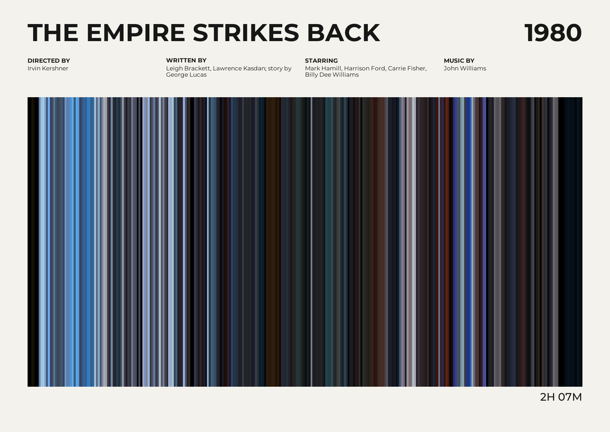

# Reelcard

[](https://github.com/colinmakerofthings/reelcard/actions/workflows/tests.yml)

Reelcard is a local command-line tool for turning a video into a postcard-sized
film-barcode print. It samples frames in chronological order, calculates a
representative colour for each, and arranges the colours as vertical stripes
within a carefully typeset poster.

> **Release:** 0.1.0 early release preview. The core workflow is usable, but
> features and command-line options may change as the project develops.

## Example output



This landscape postcard was generated from a local video; the credits were
provided as command-line options.

## Requirements

- Python 3.11 or newer.
- FFmpeg and FFprobe available on your `PATH`.

FFmpeg and FFprobe are separate system programs; installing the Python package
will not install them. Install FFmpeg using a trusted package manager for your
operating system, then check that both `ffmpeg -version` and
`ffprobe -version` work in a new terminal. For example, Windows users can use
`winget install Gyan.FFmpeg` or `choco install ffmpeg`, macOS users can use
`brew install ffmpeg`, and Debian/Ubuntu users can use
`sudo apt install ffmpeg`.

## Installation

Reelcard is not yet published on PyPI. Install the 0.1.0 preview from source:

```console
git clone https://github.com/colinmakerofthings/reelcard.git
cd reelcard
python -m venv .venv
```

Activate the environment, then run:

```console
python -m pip install --upgrade pip
python -m pip install .
```

## Usage

Examples:

```console
reelcard "My Film.mp4"
reelcard "My Film.mp4" --title "My Film" --year 1994 --stripes 600
reelcard "My Film.mp4" --output "my-film-postcard.png" --director "A. Director"
reelcard "My Film.mp4" --format svg
```

The input filename supplies the title when `--title` is omitted. By default,
Reelcard writes a sanitized title-based PNG into the current directory and
refuses to replace an existing file. Use `--force` to replace it.

Run `reelcard --help` for all options:

| Option | Description |
| --- | --- |
| `--title TEXT` | Poster title; defaults to the video filename. |
| `--year YEAR` | Optional release year from 1 to 9999. |
| `--director TEXT` | Optional director credit. |
| `--writer TEXT` | Optional writer credit. |
| `--starring TEXT` | Optional lead cast. |
| `--music TEXT` | Optional music credit. |
| `--subtitle TEXT` | Optional subtitle below the barcode. |
| `--credits TEXT` | Optional footer credits. |
| `--output PATH` | Output destination; extension must match the selected format. |
| `--format FORMAT` | Output format: `png` (default) or `svg`. |
| `--stripes N` | Number of sampled frames/stripes (default 300; maximum 10000). |
| `--size postcard` | Named print-size preset (the default). |
| `--width PX --height PX` | Custom landscape output dimensions; specify both. |
| `--dpi DPI` | Print-resolution metadata (default 300). |
| `--force` | Allow replacing an existing output file. |

The postcard preset is approximately 148 × 105 mm at 300 DPI (1748 × 1240
pixels). FFmpeg and FFprobe process the video locally; Reelcard does not use an
online movie database or require network access. Barcode colors are calculated
from the brighter 75% of each sampled frame, reducing shadow bias without an
artificial brightness lift.

## Output

Reelcard exports PNG images with print-resolution metadata by default. Choose
`--format svg` for an SVG with vector text and background; the barcode itself
is drawn as vector rectangles too. The SVG embeds the Montserrat font so the
typography remains consistent on computers without that font installed. Its
physical dimensions use the selected DPI. Video metadata is read locally using
FFprobe, and selected frames are decoded by FFmpeg.

## Supported platforms and limitations

Reelcard is designed for Windows, macOS, and Linux. FFmpeg and FFprobe must be
installed separately, and codec support depends on the FFmpeg build and input
video. Movie credits and other poster details must be entered manually; Reelcard
does not look them up online. Frame sampling can take several minutes because
each sample is decoded in a separate FFmpeg process.

## Development

Install the development dependencies instead of the runtime-only package:

```console
python -m pip install -e ".[dev]"
```

Run the test suite from the repository root with coverage reporting:

```console
python -m pytest --cov=reelcard --cov-report=term-missing
```

## Licence

Reelcard is distributed under the MIT License; see [LICENSE](LICENSE).
The bundled Montserrat font is licensed under the SIL Open Font License 1.1;
see [the font licence](src/reelcard/fonts/Montserrat-OFL.txt).
